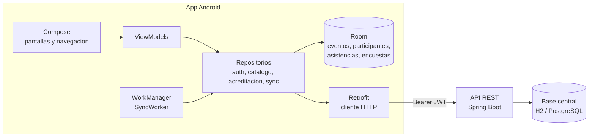

# Arquitectura — app Android

La app es el cliente offline de SyncPass: guarda catálogo, acreditaciones y encuestas en Room, y sincroniza con la API cuando hay red.

## Contenedores

## Piezas

| Pieza | Responsabilidad |
| --- | --- |
| `ui/` | Pantallas Compose, navegación y componentes |
| `ui/viewmodel/` | Estado de cada pantalla y acciones |
| `data/repository/` | Auth, catálogo, participantes, acreditación, encuestas y sync |
| `data/local/` | Room: entidades, DAOs y migraciones |
| `data/remote/` | Retrofit: login, catálogo, participantes y lote |
| `sync/` | `SyncWorker` y `SyncScheduler` |
| `auth/` | Sesión, rol y login local de respaldo |

## Flujos

- **Login:** `POST /api/auth/login`; el rol se lee del JWT. Si la API no responde y `MODO_DEMO=true`, usa el respaldo local.
- **Catálogo:** descarga proyectos y eventos y los guarda con *upsert* por `remoteId`; no borra datos locales.
- **Aprovisionamiento:** cada participante recibe un UUID y se registra en `POST /api/participantes`; el correo no se envía.
- **Acreditación:** valida evento, ventana, duplicado y cupo local; guarda en Room y encola sync.
- **Encuestas:** se responden solo si hay presencia; quedan pendientes en Room.
- **Sync:** `POST /api/sync/lote`; la clave es `(eventoId, usuarioId)`. Un `4xx` de negocio marca rechazo; `5xx` o red se reintentan.
- **WorkManager:** trabajo único al abrir, acreditar y encuestar; periódico cada 15 minutos.

## Reglas de negocio

- `estado` ausente equivale a `PRESENTE`; `validado` se deriva.
- `INSCRITO → PRESENTE` conserva `inscritoMs` y actualiza el timestamp.
- El estado más avanzado gana.
- Cupos: fila nueva con cupo lleno se rechaza; la transición existente se permite.
- La primera encuesta gana; un reenvío no pisa la respuesta.

## Seguridad

- Tokens en almacenamiento local; `Authorization: Bearer` en cada request.
- El rol decide la pantalla inicial y las acciones visibles.
- Un participante aprovisionado no tiene contraseña.
- `MODO_DEMO` es solo un respaldo de demostración.

El contrato y la arquitectura completa están en el repo de la API:
[arquitectura del sistema](https://github.com/jorgeCisternasDev/syncpass-api/blob/main/docs/arquitectura.md).
