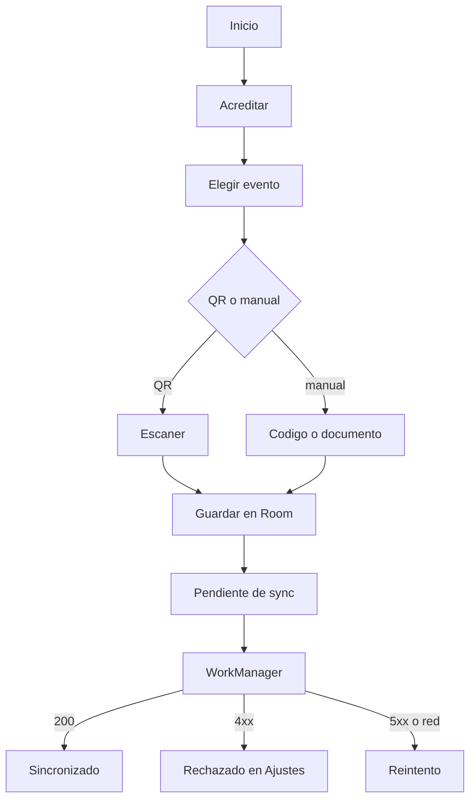

# Vistas y navegación — app Android

Rutas declaradas en `SyncPassNavHost.kt`.

| Ruta | Pantalla | Rol |
| --- | --- | --- |
| — | Login | Sin sesión |
| `home` | Inicio Monitor | Monitor |
| `accredit` | Acreditar (evento opcional) | Monitor y Coordinador |
| `surveys` | Encuestas | Monitor y Coordinador |
| `settings` | Ajustes (sync, rechazos, exportar) | Todos |
| `projects` | Proyectos descargados | Monitor y Coordinador |
| `event/new` | Nuevo evento | Coordinador |
| `event/{eventId}` | Detalle de evento | Monitor y Coordinador |
| `event/{eventId}/edit` | Editar evento | Coordinador |
| `event/{eventId}/participant` | Agregar participante | Monitor y Coordinador |
| `qr/{participantId}` | QR del participante | Monitor y Coordinador |
| `scanner/{eventId}/{useLocation}` | Escáner QR | Monitor y Coordinador |
| `survey/{attendanceId}` | Encuesta de acreditación | Monitor |
| `participant_survey/{attendanceId}` | Encuesta del participante | Asistente |
| `survey_create` | Crear encuesta | Coordinador |
| `survey_take` | Tomar encuesta | Asistente |
| `survey_custom_answer/{surveyId}` | Responder encuesta personalizada | Asistente |
| `survey_custom_results/{surveyId}` | Resultados | Coordinador |
| `indicators/{eventId}` | Indicadores | Monitor y Coordinador |

## Entrada por rol

| Rol del token | Pantalla inicial |
| --- | --- |
| `MONITOR` | Navegación completa: Inicio, Acreditar, Ajustes |
| `COORDINATOR` | Panel de coordinación |
| `PARTICIPANT` | Inicio de participante |

## Flujo de acreditación

## Estados de interfaz

- **Carga:** listas e indicadores muestran progreso.
- **Vacío:** sin eventos, sin participantes, sin respuestas.
- **Error de red:** conserva lo local y avisa; no borra la cola.
- **Rechazo:** contador y motivo en Ajustes, con descarte.

La demo paso a paso está en [demo-app.md](demo-app.md).
